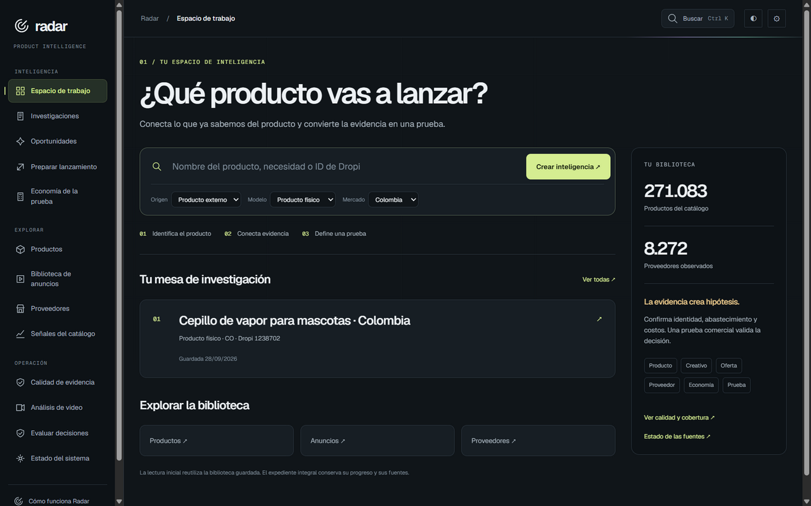
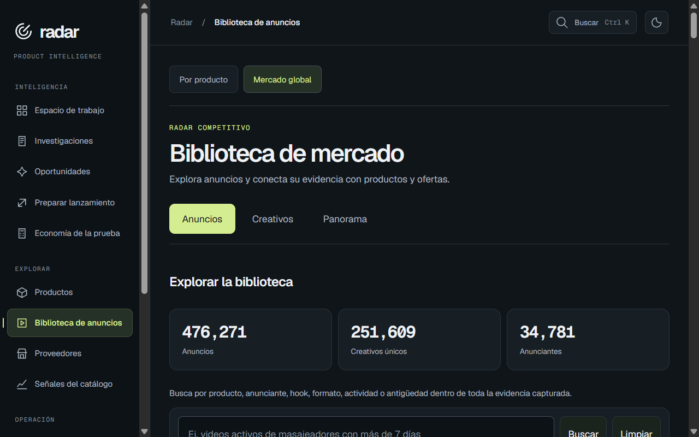
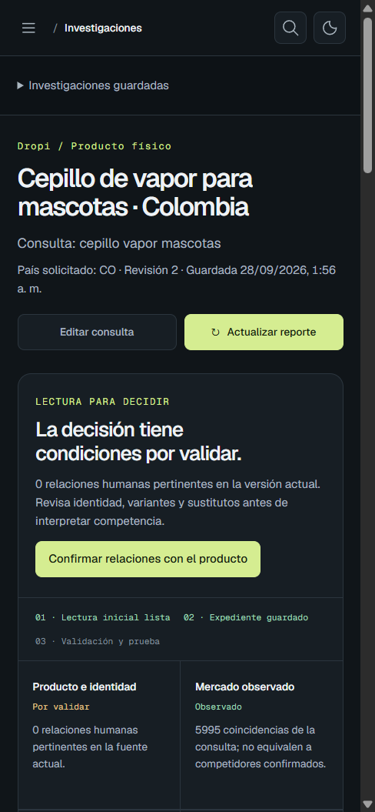
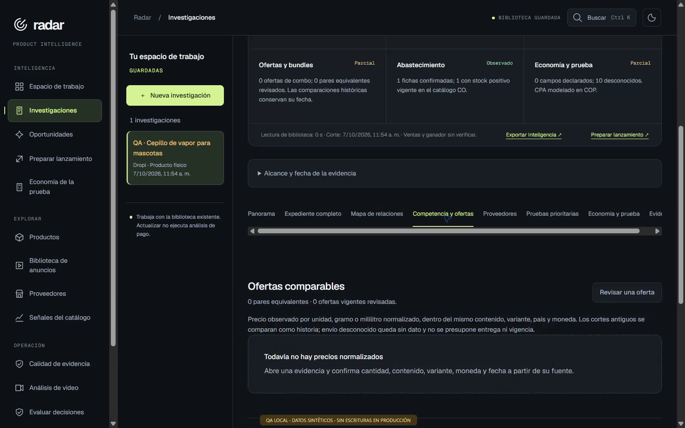
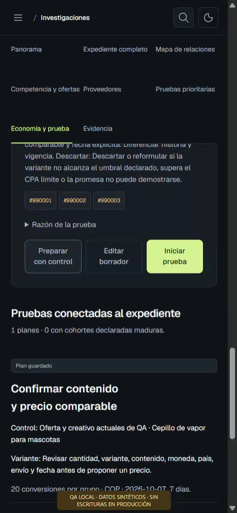

# Feature tour

Collection, research, supplier review, economics and assistant access belong to one Radar product.

[Overview](README.md) · [Capture provenance](SCREENSHOTS.md)

[Research workspace](#research-workspace) · [Investigation and decisions](#investigation-and-decisions) · [Economics](#economics)

## Research workspace

### Product and supplier workspace

Start a product investigation and navigate the product, advertising and supplier libraries.

*October 7, 2026 archived application; Spanish/dark. Catalog counts belong to that date.*

### Advertising library

Browse advertising references alongside the surrounding catalog-research tools.

*October 7, 2026 archived application; Spanish/dark. This is a library view, not campaign performance.*

## Investigation and decisions

### Saved investigation on mobile

Review the saved product brief and the decision conditions from a compact screen.

*October 7, 2026 application QA; Spanish/dark with a named QA product investigation.*

### Offer and supplier evidence

Keep competitor offers, supplier candidates and decision sections in the same investigation.

*October 7, 2026 application QA; Spanish/dark. The visible offer section has no normalized price yet.*

## Economics

### COD economics and test planning

Review the economics/evidence stage and define a test once the required conditions are known.

*October 7, 2026 application QA; Spanish/dark. The investigation is pending and has zero connected experiment results.*

## Coverage and implementation notes

| Area | Coverage boundary |
| --- | --- |
| Catalog collection, stock/price observation history and scheduled updates | These are backend components in [System](SYSTEM.md); the screenshots do not show a new collection run or uptime result. |
| Supplier matches and product variants | The investigation workflow is pictured; candidate matches still require review. |
| COD calculations and experiments | The captured test is pending. No observed sales, profit or winning experiment is claimed. |
| Read-only assistant connector | Documented in [System](SYSTEM.md); no live external-client tool session is pictured. |

[Back to overview](README.md)
