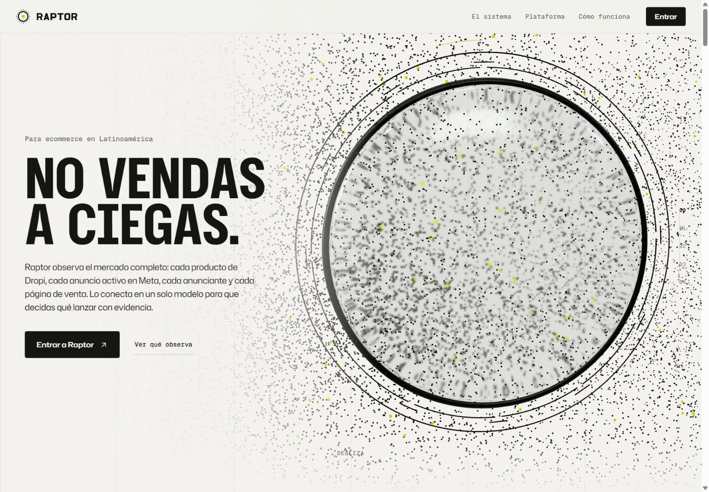
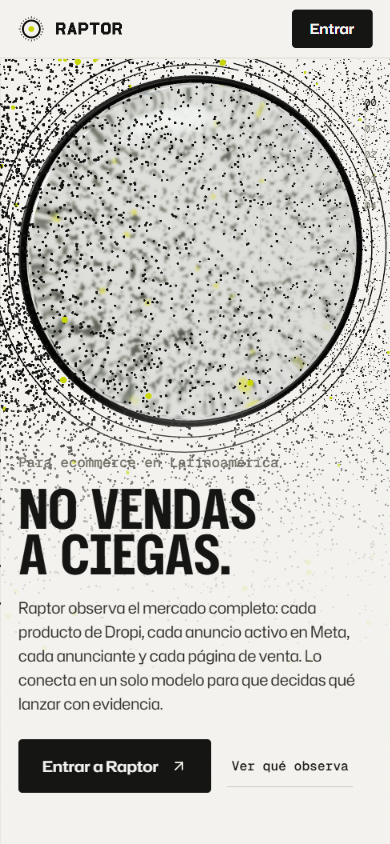
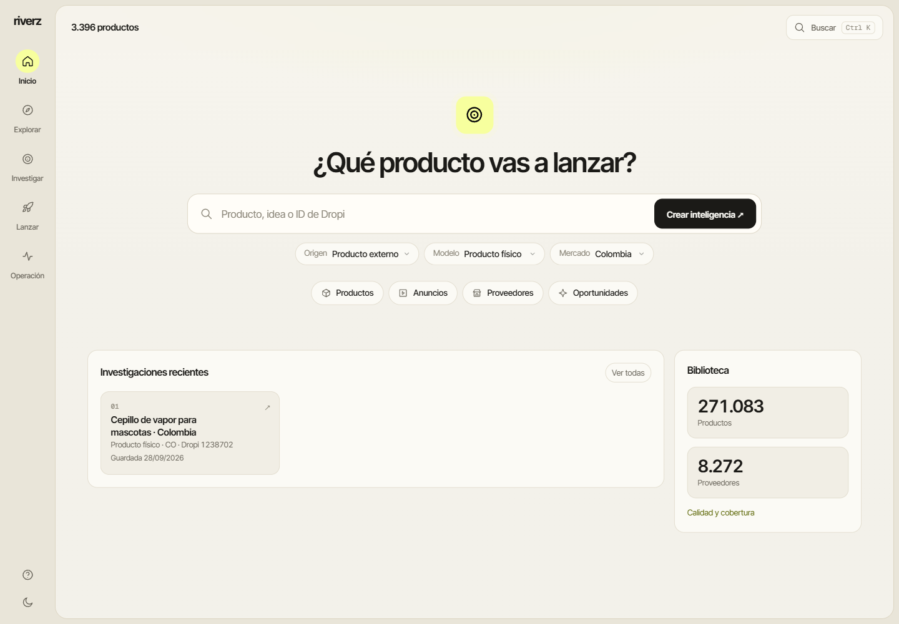
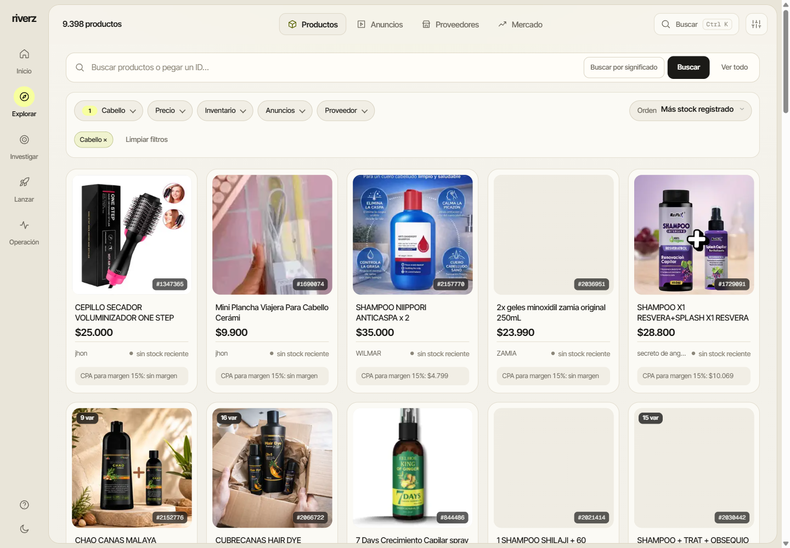
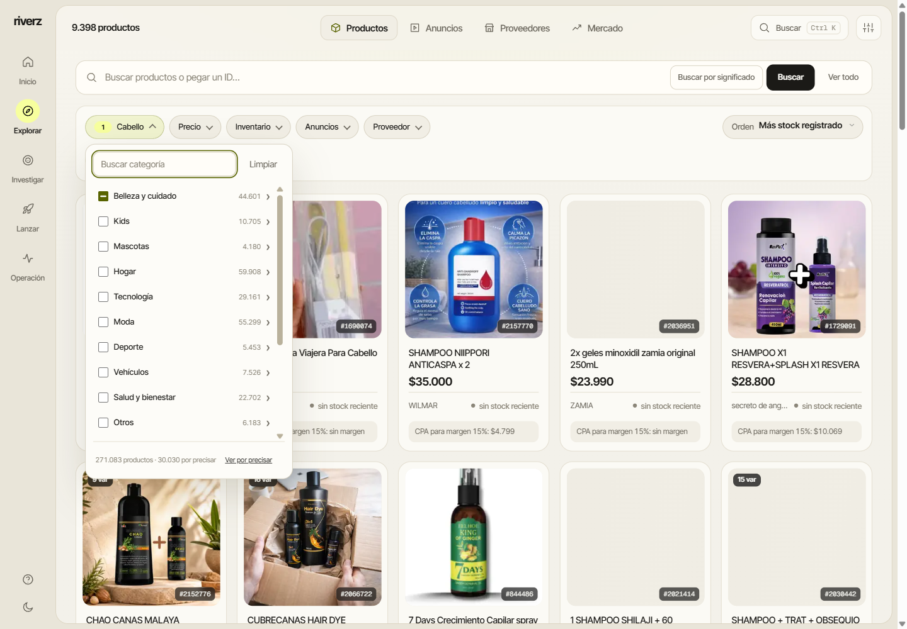
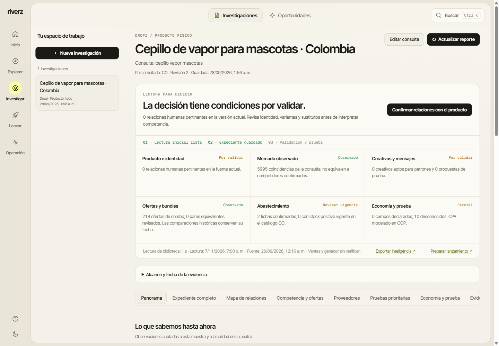
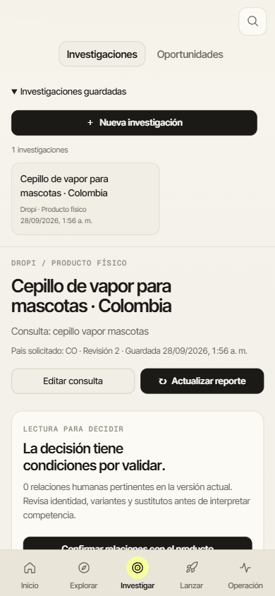
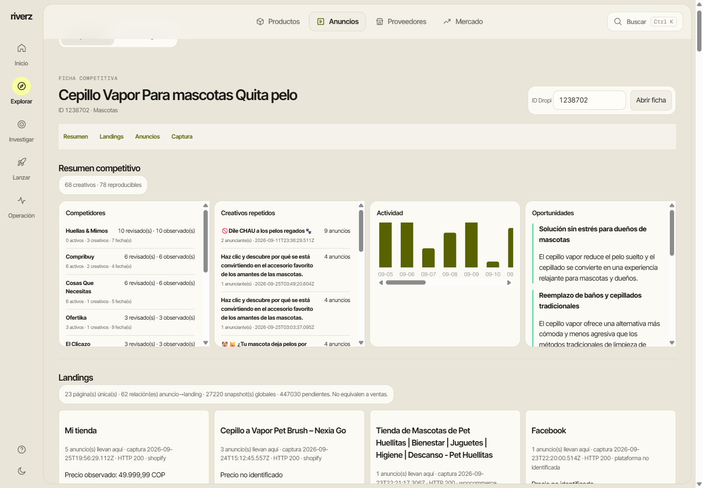
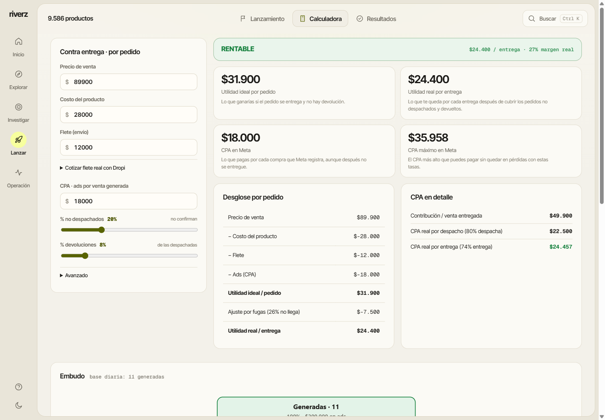
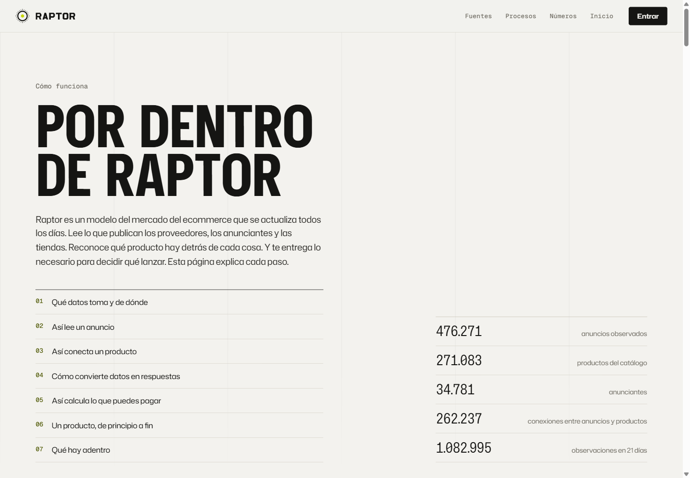

# Raptor feature tour

[Overview](README.md) · [System](SYSTEM.md) · [Capture provenance](SCREENSHOTS.md)

These are original production captures from November 7, 2026 (America/New_York), taken after the headline deployment. The application uses its native light theme and Spanish labels. Some internal document titles still use Radar. All modules belong to one product.

## 1. Landing and product entry

The public landing introduces Raptor. The authenticated start screen opens product research and the catalog, advertising and supplier areas.

The saved pet-brush record is an existing investigation. The header count reflects a retained catalog filter; the library card shows the full catalog snapshot.

## 2. Catalog and category navigation

Browse product cards, apply category filters and keep price, inventory, advertising and supplier controls together. The captured filter is **Cabello** (hair care), with 9,398 observed listings.

The interface marks stock without a recent observation. Unavailable source thumbnails remain visible as empty slots; no replacement product images were generated.

## 3. Investigations, competitors and landing evidence

A saved investigation separates observed market information, product identity, offers, supply and economics. The captured record still requires validation and has incomplete cost inputs.

Advertising activity, automatic opportunity text and published offer claims are research inputs. They do not establish confirmed product equivalence, efficacy, current stock, seller revenue or profitable campaigns. Missing prices stay unidentified. Historical evidence retains its dates.

## 4. Cash-on-delivery calculations

Model selling price, product cost, shipping, advertising cost, orders not dispatched and returns. The screen below uses the calculator's built-in example values.

The green profitability state is a calculated scenario, not an observed business result. Shipping quotes and real experiment results were not created for this gallery.

## 5. Public system guide and supporting components

The public guide explains the relationship between collection, advertising evidence, matching, investigations and decisions.

Collection, scheduled updates and authenticated read-only assistant access are documented in [System](SYSTEM.md). The screenshots do not certify uninterrupted operation, matching accuracy or a live external MCP-client session.

Earlier interface: October 7, 2026

These original Spanish/dark captures document the older interface. They are retained for history and are not presented as the current release.

- [Original workspace](assets/workspace-original-2026-10-07.png)
- [Advertising library](assets/ads-library-2026-10-07.png)
- [Mobile investigation](assets/investigation-mobile-2026-10-07.png)
- [Offer and supplier review](assets/offer-comparison-2026-10-07.png)
- [Pending economics/test view](assets/economics-test-2026-10-07.png)

[Back to overview](README.md)
