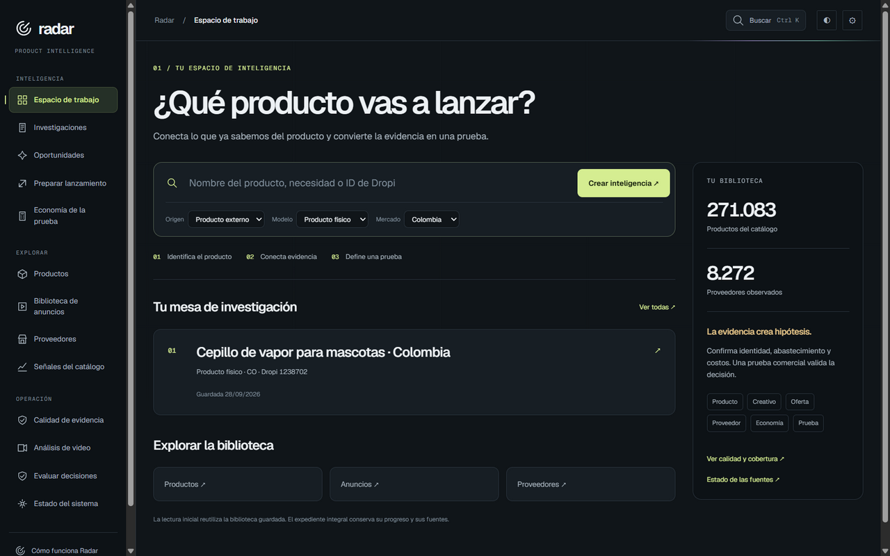

# Radar

**Catalog and supplier research for cash-on-delivery ecommerce.**

[Engineering](ENGINEERING.md) · [Contact](https://github.com/excelenciaempire/riverz-showcase/issues/new?title=Professional%20inquiry)

Radar brings catalog listings, observed stock, supplier comparisons, advertising references and unit-economics assumptions into one research workspace.

*Original application capture, October 7, 2026. The Spanish interface and catalog figures reflect that date. [Capture details](SCREENSHOTS.md).*

## My contribution

I develop the catalog-research interface, supplier workflows, matching review, persistent investigations and cash-on-delivery analysis. The surrounding system includes catalog collection and an assistant connector.

## A technical decision

Similar titles can describe different variants or bundles. Radar treats supplier matches as proposals for review and keeps observed stock separate from inferred sales. Missing costs remain unknown in the economics calculation. [Read the decisions](ENGINEERING.md).

**JavaScript · Node.js · Express · SQLite · S3-compatible object storage**

**All my development work presented here was done with AI assistance.** I use programming and software engineering fundamentals to define requirements, review code, test behavior and take responsibility for technical decisions.

This case contains documentation and a historical application screenshot. Source, databases and private research stay private. It publishes no matching-accuracy or commercial-performance metrics.
