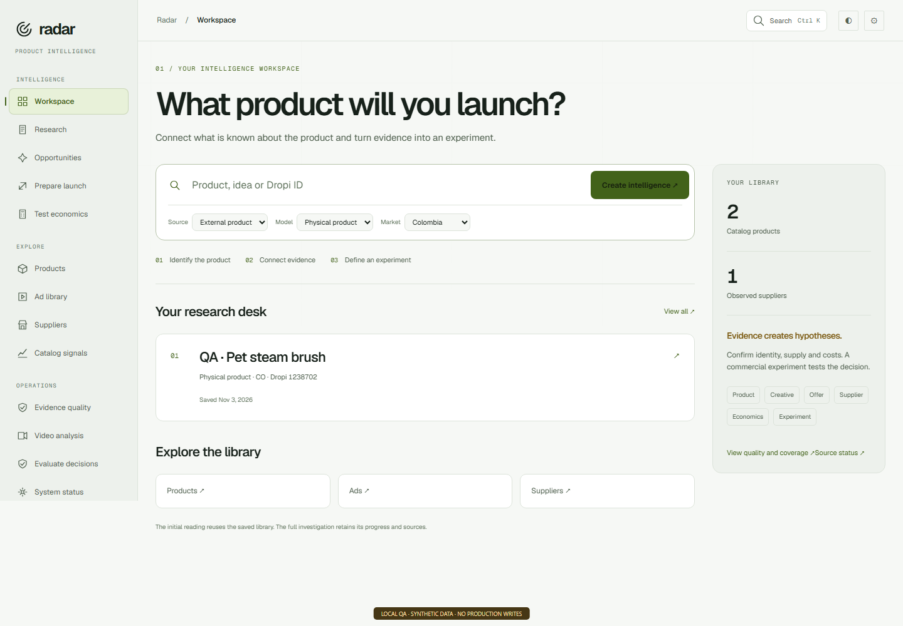

# Radar

**Product intelligence for ecommerce research.**

[Engineering notes](ENGINEERING.md) · [Juan Rios](https://github.com/excelenciaempire)

Radar connects product catalogs, suppliers, advertising observations, and cash-on-delivery economics in a research workspace. It helps turn scattered information into a product hypothesis that can be reviewed and tested.

*Internal workspace using Radar’s light theme and an isolated synthetic-data fixture. UI labels were translated locally into English for this portfolio; no shipped English-language support is implied. [Capture details](SCREENSHOTS.md).*

## The workflow

1. Start from a catalog listing, an external product, or a buyer need.
2. Review product identity, supplier information, and observed availability.
3. Compare relevant advertising evidence and offer context.
4. Examine unit economics and record the next hypothesis to test.

## How I build with AI

**All of my development work presented here was done with AI assistance.** I use AI throughout implementation, debugging and validation. I understand programming and software engineering fundamentals, and use them to define requirements, guide the tools, review changes and check how the software actually behaves. I take responsibility for technical decisions and results.

## My work

I develop the product research experience, catalog and supplier workflows, evidence handling, and decision-support tools. A core concern is making the limits of the data visible where a user makes a decision.

## Representative capabilities

- Catalog search and dated availability observations.
- Proposed cross-supplier matches with explicit review.
- Persistent product investigations and source references.
- Cash-on-delivery cost and break-even analysis.
- Advertising-library evidence with clear interpretation limits.

## Stack

**JavaScript · Node.js · Express · SQLite · S3-compatible object storage**

## Engineering focus

Similar product titles do not prove that two suppliers sell the same variant. A stock reduction does not prove a sale. An advertisement remaining visible does not prove that it is profitable.

Radar keeps observations, algorithmic proposals, human decisions, and commercial hypotheses distinct. The [engineering notes](ENGINEERING.md) describe matching evaluation, data freshness, and missing-data behavior.

## Repository scope

This is a public case study. Source code, catalog databases, account configuration, and private research remain private. No catalog-size, matching-accuracy, revenue, or advertising-performance claims are made here.

For professional inquiries, [contact me through the Riverz showcase](https://github.com/excelenciaempire/riverz-showcase/issues/new?title=Professional%20inquiry).
