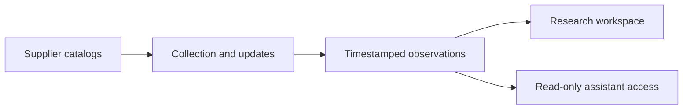

# Raptor: one product, three connected parts

The catalog collector, research workspace and read-only assistant connector are components of Raptor. They are presented together in this case study.

## Catalog collection

**Work:** The data-collection side of Raptor: catalog listings, product details, supplier information, observed stock and price history.

**My contribution:** Building the collection/update workflow, persistent observations and scheduled operation that supply Raptor. The repository documents a daily VPS process; that source documentation is separate from a new uptime check.

**Stack and status:** Python and catalog data-processing tools. A supporting data system for [Raptor](https://github.com/excelenciaempire/radar-showcase), not an additional consumer product. Stock changes remain observations rather than proven sales.

## Assistant access

**Work:** Read-only access to the catalog for AI assistants through MCP, with reusable assistant workflows.

**My contribution:** Wrapping catalog queries and product/supplier context in a tool interface assistants can use, alongside the collection system and Raptor's research interface.

**Stack and status:** An authenticated Node.js MCP endpoint exposes selected read-only catalog, taxonomy, status and documentation queries. It does not execute models, apply classification decisions or provide unrestricted database access. This is a component of Raptor, not a separate product.

## Research workspace

The web application supports catalog review, supplier matching, retained investigations, advertising references and cash-on-delivery calculations. Collection and assistant access support that same product.

**System stack:** JavaScript/Node.js, Express, SQLite, Python, MCP and S3-compatible object storage.

[Product overview](README.md) · [Engineering decisions](ENGINEERING.md)
